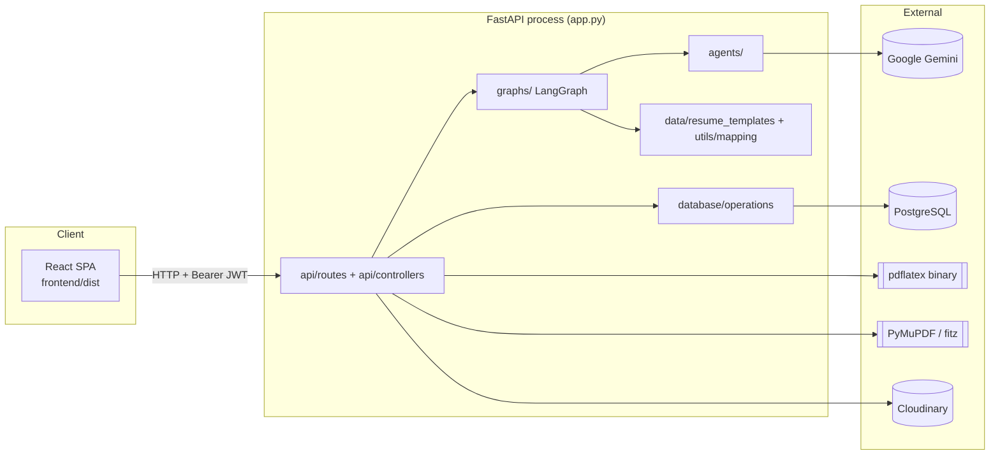
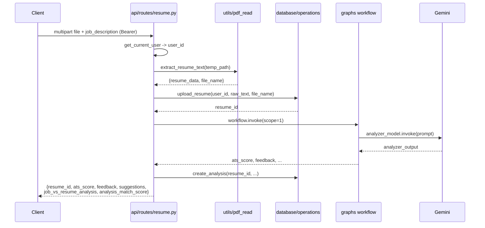
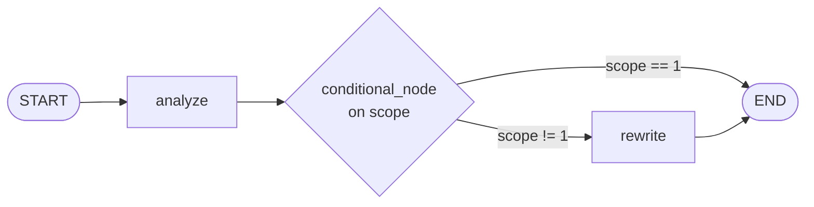
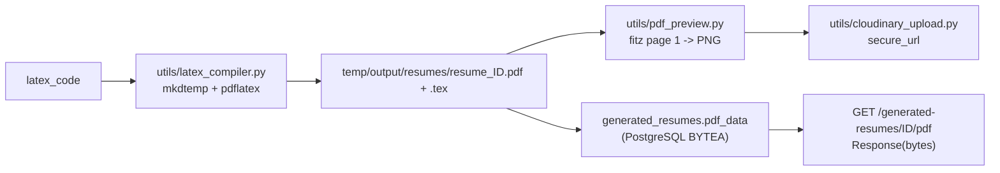

# Architecture

This document describes how the AI Resume Analyzer is put together: the
runtime processes, the request lifecycles, the layering, and the data and
template subsystems. It is derived from the source on disk; where behaviour is
subtle or surprising it points at the exact file and line.

For installation, endpoint-by-endpoint usage, and configuration values see
[`../README.md`](../README.md). For the frontend see `frontend/` (out of scope
here).

---

## 1. What the system is

A resume analysis, job-matching, and rewriting service. A user uploads a PDF
resume (optionally with a job description), receives a scored analysis, and can
have the resume rewritten into one of eleven LaTeX templates and compiled to a
PDF.

It ships four entry points:

| Entry point | File | Role |
|---|---|---|
| Web API | `app.py` | FastAPI app; the primary interface. Also serves the built SPA. |
| Web UI | `frontend/` | React 19 + Vite SPA (separate process/artifact). |
| CLI | `extras/main.py` | Local file-dialog flow over the same workflow. |
| Experimentation harness | `extras/local_workflow.py` | Single-file copy of the LangGraph pipeline. |

`app.py` and `extras/main.py` both drive the LangGraph workflow in `graphs/`; the
LLM agents, templates, and guidelines are shared.

> Standalone scripts and dead modules live in `extras/` (see
> [`../extras/README.md`](../extras/README.md)). None of them are imported by
> `app.py`; the API's import closure is unaffected.

---

## 2. System context



Three of those dependencies are *local-process* dependencies worth calling out
because they dominate deployability: `pdflatex` is invoked as a subprocess,
`fitz` (PyMuPDF) renders previews in-process, and the compiled PDF is persisted
in PostgreSQL (`generated_resumes.pdf_data`) while LaTeX/PNG intermediates are
written to the system temp directory. See
[§12](#12-runtime-infrastructure-assumptions).

---

## 3. Layering and dependency direction

The backend follows a one-directional call chain:

```
app.py
  └─ api/routes/*            HTTP surface: parsing, auth dependency, status codes
       └─ api/controllers/*  business logic / orchestration
            ├─ graphs/*       LangGraph workflow (nodes, state, compilation)
            │    └─ agents/*  LLM wrappers
            │         └─ llms/*        provider clients
            │              └─ models/* structured output schemas
            ├─ database/operations/*   repositories (raw SQL)
            │    └─ database/db.py     engine
            └─ utils/*        jwt, latex, pdf, mapping, candidate extraction
```

Rules the code follows:

- **Routes do not contain business logic.** `api/routes/resume.py` parses the
  multipart upload, resolves the authenticated `user_id`, and delegates to
  `api/controllers/resume.py`.
- **Controllers own the workflow invocation and persistence.** They call the
  compiled graph, then write rows via `database/operations/`.
- **Repositories are the only code that talks SQL.** They import `text` and
  `engine` from `database/db.py`.
- **`utils/` is a leaf.** Nothing in `utils/` imports from `api/`.

### Module import graph (and import-time side effects)

Several modules do real work at import time, which matters for startup order and
cold-start cost:

- `database/db.py:3` — creates the SQLAlchemy engine with `echo=True` and prints
  `"connected"`.
- `llms/gemini.py:6` — constructs the `ChatGoogleGenerativeAI` client.
- `models/classes.py` / `llms/gemini.py:22` — `gemini.register()` calls
  `get_or_create_model(...)`, which performs an **INSERT/upsert against the
  database at import time**. Importing the LLM layer therefore requires a live,
  migrated database.
- `utils/mapping.py:10` — eagerly imports all eleven `template_*.py` modules.
- `graphs/nodes.py:78` — instantiates the singleton `ResumeAgent(analyzer,
  rewrite)`.

Because `app.py` imports the routers, which import controllers → graphs →
agents → llms, **booting the server touches the database and all templates**.

---

## 4. Request lifecycles

### 4.1 `POST /analyze_resume` (analysis only, `scope=1`)



Steps (`api/routes/resume.py:23-68`):

1. The upload is streamed to a `tempfile.NamedTemporaryFile` (`:29`).
2. An empty `job_description` is replaced with a default tailoring prompt
   (`:34-35`).
3. `utils.pdf_read.extract_resume_text` (`utils/pdf_read.py:29`) concatenates
   per-page text with `pypdf`. Empty/scanned PDFs raise `ValueError` (`:42`).
4. `upload_resume` inserts a `resumes` row and returns `resume_id` via
   `RETURNING` (`database/operations/upload_resume.py:4`).
5. The graph runs with `scope=1`, stopping after analysis.
6. The analysis is persisted, then a flat JSON body is returned.
7. The temp file is always removed in a `finally` (`:67-68`).

### 4.2 `POST /rewrite_resume` (analysis + rewrite, `scope=2`)

Same prefix, then the rewrite branch (`api/routes/resume.py:70-156`):

1. `template_id` (a **form field**, required) is passed to the controller as the
   graph's `resume_format` (`:98`). This rename at the HTTP boundary is the
   source of a recurring confusion: the field is `template_id`, the state key is
   `resume_format`.
2. The graph runs both nodes and returns `latex_code`.
3. `generate_pdf_from_latex(...)` compiles the LaTeX to
   `{tempfile.gettempdir()}/output/resumes/resume_{resume_id}.pdf`
   (`utils/latex_compiler.py:14`).
4. `generate_pdf_preview(...)` renders page 1 to a PNG with PyMuPDF
   (`utils/pdf_preview.py:12`).
5. `upload_resume_preview(...)` uploads that PNG to Cloudinary and returns a
   secure URL (`utils/cloudinary_upload.py:4`).
6. `save_generated_resume(...)` inserts a **single** row carrying the LaTeX, the
   Cloudinary `preview_img_url`, and the compiled PDF bytes (`pdf_data`) —
   `api/routes/resume.py:133` reads them with `Path(pdf_path).read_bytes()`.
7. Response adds `pdf_url` (`/generated-resumes/{resume_id}/pdf`),
   `preview_img_url`, and `new_resume_id`.

### 4.3 `GET /generated-resumes/{resume_id}/pdf`

`api/routes/resume.py:171`. Loads `generated_resumes.pdf_data` from PostgreSQL
(joining `resumes` to confirm the row belongs to the authenticated `user_id`)
and returns it as a `Response` with `Content-Disposition: attachment`, or 404s.
It reads **durable database storage**, not the local filesystem — so it survives
ephemeral, multi-instance hosts ([§12](#12-runtime-infrastructure-assumptions)).

### 4.4 Auth endpoints

`api/routes/auth.py` — `POST /add/user`, `POST /login/user`, `GET /my/profile`.
See [§6](#6-auth-and-session-model).

---

## 5. HTTP API surface

| Method | Path | Auth | Handler | Persists |
|---|---|---|---|---|
| POST | `/add/user` | — | `api/routes/auth.py:17` | `users` |
| POST | `/login/user` | — | `api/routes/auth.py:22` | `auth_sessions` |
| GET | `/my/profile` | Bearer | `api/routes/auth.py:27` | — (returns `{user_id}` only) |
| POST | `/analyze_resume` | Bearer | `api/routes/resume.py:24` | `resumes`, `resume_analysis` |
| POST | `/rewrite_resume` | Bearer | `api/routes/resume.py:71` | `resumes`, `resume_analysis`, `generated_resumes` (incl. `pdf_data`) |
| GET | `/generated-resumes/{id}/pdf` | Bearer | `api/routes/resume.py:171` | — (reads `generated_resumes.pdf_data`) |
| GET | `/templates` | — | `api/routes/resume.py:196` | — |
| GET | `/analysis-history` | Bearer | `api/routes/resume.py:159` | — |
| GET | `/rewrite-history` | Bearer | `api/routes/resume.py:166` | — |

`GET /resumes` is referenced in the frontend but **not implemented**.

### Response-shape trap

`job_vs_resume_analysis` is a **string** and `analysis_match_score` is its
**top-level sibling**. The Pydantic model nests them
(`models/structured_outputs.py:3-11` as `job_vs_resume_analysis_class`), but
`graphs/nodes.py:91-92` flattens the object on the way out of the graph:

```python
"job_vs_resume_analysis": response.job_vs_resume_analysis.job_analysis_feed_back,
"analysis_match_score":    response.job_vs_resume_analysis.analysis_match_score,
```

Consumers that expect the nested object silently read `undefined`. The same
flattening is duplicated in `extras/local_workflow.py`.

---

## 6. Auth and session model

Implemented in `api/controllers/auth.py` over `utils/jwt.py`,
`utils/token_hash.py`, and `database/operations/auth*.py`.

- **Registration** (`:26`) hashes the password with `pwdlib`'s recommended
  Argon2 hasher (`:28-30`) and inserts a `users` row.
- **Login** (`:58`) verifies the password, then mints:
  - an **access token** (HS256, `type="access"`, default 300 min);
  - a **refresh token** (`type="refresh"`, default 7 days).
  Only a **SHA-256 hash** of the refresh token is stored, in `auth_sessions`
  (`:92-101`), which also captures device/IP/user-agent and an expiry.
- **Bearer guard** `get_current_user` (`:119`) decodes the JWT, requires
  `type == "access"`, and returns `int(sub)` — the `user_id` every protected
  route depends on.
- **Refresh** `refresh_access_token` (`:155`) exists and is fully implemented
  (validates DB session, checks revocation and expiry, re-verifies the JWT) but
  **no route calls it**. `TOKEN_HASH` is SHA-256, so it is a lookup key, not a
  password hash.
- **Logout** (`:240`) is idempotent and revokes the session.

Token claims are `sub` (stringified user id), `type`, and `exp`
(`utils/jwt.py:15-19`). Signing key and algorithm come from
`settings.JWT_SECRET_KEY` / `settings.JWT_ALGORITHM`.

> Note: an empty `JWT_SECRET_KEY` default (`config/settings.py:15`) means the
> server will happily sign with an empty secret if the env var is missing. Set
> it in every environment.

---

## 7. LangGraph workflow

Compiled in `graphs/resume_workflow.py`:



- **State** — `graphs/agent_states.py` defines `agentState` as a `TypedDict`
  carrying `data`, `guidelines`, `job_description`, `scope`, `resume_format`,
  the analysis outputs, and `latex_code`.
- **`analyze`** (`graphs/nodes.py:80`) calls `ResumeAgent.analyze_resume` with a
  prompt that embeds the 30-section guidelines, the resume text, and the JD.
- **`conditional_node`** (`:120`) routes to `"end"` when `scope == 1`, else
  `"rewrite"`.
- **`rewrite`** (`:96`) looks up `template_map` / `format_rules_map` for the
  chosen template, calls the rewriter, extracts candidate identity from the
  **original** text via `extract_candidate_info`, and reassembles the final
  LaTeX with `assemble_map[...](latex_code, info=info)`. It returns
  `max(original_ats, rewritten_ats)`.

The controller (`api/controllers/resume.py`) wraps invocation in a broad
`try/except`: analysis swallows exceptions and returns
`{"message": "resume analysis failed", "success": False}` (`:22-26`) — which is
*not* the documented response shape — while rewrite re-raises (`:53-55`).

`extras/local_workflow.py` re-implements the same graph in one file for isolated
experimentation; `extras/main.py` drives the workflow directly (and references
`graphs.resume_workflow`, the actual module name).

---

## 8. LLM layer

`llms/gemini.py` builds a `ChatGoogleGenerativeAI` client and registers it as a
`BaseLLM` (`models/classes.py`). `BaseLLM.register()` upserts a row into
`llm_models` and stores the returned `model_id`; agents expose that id
(`analyzer_model_id`, `rewrite_model_id`) so analyses and generated resumes can
record which model produced them.

Structured output uses `with_structured_output` against Pydantic schemas in
`models/structured_outputs.py`:

- `analyzer_output` → `ats_score`, `feedback`, `suggestions`, and a nested
  `job_vs_resume_analysis_class`.
- `rewrite_output` → `ats_score`, `latex_code`.

Mistral and NVIDIA clients exist (`llms/mistral.py`, `llms/nvidia.py`) as
alternates; the agents currently import Gemini. API keys are read by the
provider SDKs from `os.environ`, which `config/settings.py:32-40` populates from
the centralized `Settings`.

---

## 9. Template subsystem

The most bespoke part of the codebase. Each `data/resume_templates/template_N.py`
exposes `format`, `format_rules`, `assemble`, and `img_preview`.

### 9.1 Structure of a template

- **`LOCKED_TOP`** (`template_1.py:33`) — `\documentclass`, preamble, macros,
  and a header containing `@@FULLNAME@@` / `@@HEADER_CONTENT@@` tokens. The
  model is told never to change it.
- **`BODY_MARK` + `BODY`** — the only region the model rewrites.
- **`format`** — `LOCKED_TOP + BODY`, pasted into the rewrite prompt.
- **`format_rules`** — strict rules the model must follow for valid LaTeX.
- **`assemble(model_output, info=None)`** — discards whatever the model produced
  for the top and re-attaches the locked preamble plus a header rendered from
  `info`.

### 9.2 Per-call identity (why templates are shareable)

Historically each template baked a module-level `INFO` dict into its header at
import time, so every user's resume showed the template author's name. Identity
is now supplied **per call**: `graphs/nodes.py:107` extracts it from the
uploaded resume and passes it to `assemble`. Shared logic lives once in
`data/resume_templates/_common.py`:

- `esc()` / `ESCAPE_MAP` — LaTeX escaping.
- `resolve_info()` — normalizes a candidate dict, falling back to
  `PLACEHOLDER_INFO` so a missing field renders as `[CANDIDATE NAME]` etc.
  rather than someone's real details.
- `render_header()` — builds the `\href`/`\link` header tokens, with `_with_scheme`
  ensuring bare hosts become absolute URLs.

### 9.3 Discovery and the index coupling

`utils/mapping.py:10-15` globs `template_*.py`, parses the trailing integer, and
builds `template_map`, `assemble_map`, and `format_rules_map` keyed `1..11`.
`utils/mapping.py` has no DB dependency; `extras/data/resume_templates/seed_templates.py`
performs the parallel job of seeding the `resume_templates` table (name, version,
preview image, style metadata) and derives metadata by regex-scanning the source.

> The LaTeX template index and `resume_templates.template_id` must agree. The
> seed script keys rows by `template_key` (`template_N`) and upserts them; the
> rewrite path maps the HTTP `template_id` straight into `format_rules_map`
> / `template_map`. If the two numbering schemes drift, a valid `template_id`
> can select the wrong template.

### 9.4 Sidebar pagination

Templates 2–5 have a two-column sidebar. It used to be a `tabular`, which cannot
break across pages: once the body outgrew a page, TeX pushed the whole box to
page 2 and left page 1 blank. The sidebar is now page furniture drawn with
`eso-pic`:

- `\AddToShipoutPictureBG` paints the band/hairline on **every** page;
- `\AddToShipoutPictureFG*` paints the name + contact block on page 1 only;
- body text flows in the remaining margin.

`\AtPageLowerLeft` / `\AtPageUpperLeft` position against absolute page
coordinates, so this is correct on a **single** `pdflatex` pass — which matters
because `utils/latex_compiler.py` compiles exactly once. A TikZ
`remember picture` anchor would need two passes and render blank the first time.

### 9.5 Candidate identity extraction

`utils/candidate_info.py` lifts `fullname`, `email`, `phone`, `location`, and
`links` from the first lines of the extracted resume text using tuned regexes
and heuristics (`_name_is_plausible`, `_TITLE_WORDS`, `_looks_like_date`, …).
Every field is optional; missing ones are omitted and the template falls back to
a placeholder. This exists because `/my/profile` stores only `user_id`, and
because asking the model to copy the header across is unreliable.

### 9.6 Tests

`tests/` compiles all eleven templates on a single `pdflatex` pass and asserts
mapping/identity/placeholder behaviour, absence of blank pages on a long
fixture, per-page sidebar furniture, and identity extraction. Tests that need
`pdflatex` skip when it is absent. `pytest` is not declared in
`requirements.txt`.

---

## 10. PDF pipeline



- `generate_pdf_from_latex` (`utils/latex_compiler.py:7`) writes the `.tex` into a
  fresh `tempfile.mkdtemp()`, runs
  `pdflatex -interaction=nonstopmode -halt-on-error` with `cwd=temp_dir`, and on
  success copies both `.pdf` and `.tex` to the system temp dir
  (`Path(tempfile.gettempdir())/output/resumes/`, `:14`). Failure raises
  `RuntimeError` with captured stdout/stderr.
- `generate_pdf_preview` (`utils/pdf_preview.py:6`) opens the PDF with PyMuPDF
  (`import fitz`), renders page 1 at 1.5× to a PNG under the system temp dir
  (`Path(tempfile.gettempdir())/output/resume-previews/`, `:12`).
- `upload_resume_preview` (`utils/cloudinary_upload.py:4`) uploads that PNG.
  **`config/cloudinary.py` (which calls `cloudinary.config(...)`) is never
  imported**, so the SDK relies on the `CLOUDINARY_URL` environment variable;
  the `CLOUDINARY_*` names are not in `.env.example`.
- `save_generated_resume` (`database/operations/generate_resume.py:4`) persists
  the compiled bytes in `generated_resumes.pdf_data`, read back with
  `Path(pdf_path).read_bytes()` (`api/routes/resume.py:133`).

Intermediates now live in the system temp directory (not `Path.cwd()`), so the
pipeline only needs a writable scratch dir. Durability is split in two: the
Cloudinary preview URL for the thumbnail, and `generated_resumes.pdf_data` for
the **PDF bytes themselves** — the compiled file never has to outlive the
request.

---

## 11. Data layer

`database/db.py` creates the engine from `settings.DATABASE_URL` with
`echo=True` (logs every statement) and no pool tuning. Repositories use raw
SQLAlchemy `text()` statements, not the ORM.

`database/migrations/create_tables.py::create_all_tables()` fans out to 16 DDL
functions in `database/migrations/schema_tables/schema_tables.py`, then runs the
idempotent `alter_generated_resumes_add_pdf_data()`
(`ALTER TABLE generated_resumes ADD COLUMN IF NOT EXISTS pdf_data BYTEA`) so an
existing database picks up the PDF column. There is no migration framework and
no auto-run on startup — run it once manually against each database.

| Table | Purpose |
|---|---|
| `users` | Accounts (`user_id`, name, email, password hash) |
| `auth_sessions` | Refresh-token sessions (hashed token, expiry, revocation) |
| `resumes` | Uploaded resume text + filename |
| `candidate_profiles` | Parsed profile snapshots (largely unused today) |
| `job_descriptions` | Saved JDs (mostly reserved) |
| `resume_templates` | Template catalog for the picker |
| `llm_models` | Provider/model registry, upserted at import |
| `resume_analysis` | One row per analysis run |
| `resume_analysis_scores` | Per-dimension scores |
| `analysis_feedback_items` | Structured Problem/Why/Fix items |
| `analysis_runs` | Run-level tracing |
| `workflow_steps` | Per-node tracing |
| `llm_requests` | Token/latency/cost bookkeeping |
| `prompt_versions` | Prompt versioning |
| `resume_version` | Links source resume → generated resume + score |
| `generated_resumes` | Rewrite output (latex, preview URL, compiled PDF `pdf_data`) |

**The DDL is PostgreSQL-specific.** It uses `BIGINT GENERATED ALWAYS AS
IDENTITY`, `JSONB`, `TIMESTAMPTZ`, and `INET`, plus `ON CONFLICT (...)` upserts
and a `LATERAL` join in `get_rewrite_history`. The default
`DATABASE_URL = "sqlite:///resume_agent.db"` in `config/settings.py:14` therefore
does **not** match the schema — the app is built for Postgres.

> `generated_resumes.pdf_storage_key` remains in the schema but is legacy/unused.
> The compiled PDF is stored in `generated_resumes.pdf_data` and served straight
> from the database ([§12](#12-runtime-infrastructure-assumptions)).

---

## 12. Runtime infrastructure assumptions

The architecture quietly assumes a **long-lived, stateful host**. These are not
bugs in the local design, but they are the constraints any deployment must
honour:

- **A TeX toolchain on `PATH`.** `utils/latex_compiler.py` shells out to
  `pdflatex`; without TeX Live/MiKTeX the rewrite path raises. The PyPI package
  named `pdflatex` in `requirements.txt:9` is a Python wrapper, not the engine.
- **A writable scratch directory.** The compiler and previewer write
  intermediates to the system temp dir (`tempfile.gettempdir()/output/...`).
  Serving no longer depends on disk: the compiled PDF is persisted in
  `generated_resumes.pdf_data`, so an ephemeral, per-invocation filesystem is
  fine.
- **A migrated PostgreSQL instance reachable at import time.** The engine and
  the `llm_models` upsert run at import.
- **Unbounded request duration.** A rewrite chains two LLM calls, a `pdflatex`
  run, a rasterization, and an upload, all synchronously inside one request.
- **Dependencies.** `requirements.txt` now declares the runtime set
  (`SQLAlchemy`, `PyMuPDF`/`fitz`, `python-multipart`, `email-validator`, ...).
  `ttkbootstrap` and the Mistral/NVIDIA clients are marked Optional because only
  the relocated CLI/harness (`extras/`) uses them.

Consequently a serverless deployment still needs a TeX binary, a writable temp
dir, and enough time for two LLM calls plus `pdflatex`. Persistent state is no
longer the blocker: the external database holds the resume rows and the compiled
PDF (`pdf_data`), so the ephemeral, per-instance filesystem only ever holds
scratch files for the duration of a request. The analysis-only endpoints remain
closest to serverless-compatible once the database is externalized. A detailed
deployment assessment is maintained separately.

---

## 13. Configuration

`config/settings.py` centralizes configuration with `pydantic-settings`,
reading `.env` (also via `load_dotenv()` in `app.py:10` and
`config/cloudinary.py:4`). Keys: `GOOGLE_API_KEY`, `MISTRAL_API_KEY`,
`NVIDIA_API_KEY`, `DATABASE_URL`, `JWT_SECRET_KEY`, `JWT_ALGORITHM`,
`JWT_ACCESS_TOKEN_EXPIRE_MINUTES`, `JWT_REFRESH_TOKEN_EXPIRE_DAYS`.

`Settings` mirrors the API/JWT keys into `os.environ` (`:32-40`) so the
LangChain providers pick them up. `.env.example` documents only the three LLM
keys — it omits `JWT_SECRET_KEY`, `DATABASE_URL`, and the Cloudinary variables.

CORS is configured in `app.py:18-30` from `CORS_ORIGINS` (comma-separated). With
`allow_credentials=True`, an explicit origin list is required; `*` will not
work.

The SPA is served by an unconditional
`app.mount("/", StaticFiles(directory="frontend/dist", html=True))`
(`app.py:39`). The mount path is relative to the process CWD, and
`frontend/` is git-ignored (`.gitignore:60`), so a deployment must arrange for
`frontend/dist` to exist.

---

## 14. Cross-cutting concerns and known gaps

- **Error handling is uneven.** `analyze_resume` swallows all exceptions and
  returns a shape that differs from the documented one
  (`api/controllers/resume.py:22`); `rewrite_resume` re-raises. Auth controllers
  catch broadly and return `{success: False}` messages rather than raising
  `HTTPException`.
- **Unused refresh flow.** `refresh_access_token` / `logout` are implemented but
  unreachable; there is no `/refresh` or `/logout` route.
- **Dead code (now in `extras/`).** `extras/data/format.py` still holds a legacy
  `assemble(model_output)` with baked-in identity and is imported nowhere.
  `extras/database/operations/candidate_profile.py` is an empty stub and
  `extras/database/migrations/schema_tables/v2/` is a commented-out schema.
- **Unimplemented API.** `GET /resumes` has no route.
- **Undeclared runtime dependency.** `PyMuPDF` (`fitz`).
- **Noisy engine.** `create_engine(..., echo=True)` logs all SQL.
- **`services/` and `prompts/`** were reserved-but-empty; their `__init__.py`
  files now live in `extras/`.
- **Frontend lint.** Two pre-existing `react-refresh/only-export-components`
  errors (`AuthContext`, `ThemeContext`).

---

## 15. Module reference

| Path | Responsibility |
|---|---|
| `app.py` | FastAPI app, CORS, router registration, static SPA mount |
| `extras/main.py` | CLI: file dialog → workflow → print/compile (relocated) |
| `extras/local_workflow.py` | Single-file experimental copy of the graph (relocated) |
| `config/settings.py` | Centralized typed settings |
| `config/cloudinary.py` | Cloudinary config (never imported) |
| `api/routes/auth.py` | `/add/user`, `/login/user`, `/my/profile` |
| `api/routes/resume.py` | resume analysis/rewrite/templates/PDF/history routes |
| `api/controllers/auth.py` | registration, login, JWT guard, refresh, logout |
| `api/controllers/resume.py` | workflow orchestration for analyze/rewrite |
| `graphs/agent_states.py` | `agentState` TypedDict |
| `graphs/nodes.py` | `ResumeAgent`, `analyze`, `rewrite`, `conditional_node` |
| `graphs/resume_workflow.py` | compiled StateGraph |
| `agents/analyzer_agent.py` | analyzer model + `analyzer_model_id` |
| `agents/resume_rewrite_agent.py` | rewrite model + `rewrite_model_id` |
| `llms/gemini.py` | Gemini provider client |
| `extras/llms/mistral.py`, `extras/llms/nvidia.py` | alternate provider clients (unused, relocated) |
| `models/classes.py` | `BaseLLM` registration into `llm_models` |
| `models/structured_outputs.py` | analyzer/rewrite Pydantic schemas |
| `extras/models/schemas/auth.py` | unused API auth schemas (relocated) |
| `data/guidelines.py` | analysis/ATS guidelines text |
| `extras/data/format.py` | legacy dead template (relocated) |
| `data/resume_templates/template_1..11.py` | LaTeX templates |
| `data/resume_templates/_common.py` | escaping, header rendering, placeholders |
| `extras/data/resume_templates/seed_templates.py` | seeds `resume_templates` (relocated) |
| `utils/mapping.py` | auto-discovery of templates |
| `utils/candidate_info.py` | identity extraction from resume text |
| `utils/latex_compiler.py` | LaTeX → PDF via `pdflatex` (temp-dir output) |
| `utils/pdf_preview.py` | PDF page 1 → PNG via PyMuPDF (temp-dir output) |
| `utils/cloudinary_upload.py` | preview upload |
| `utils/pdf_read.py` | PDF text extraction (+ CLI dialog) |
| `utils/jwt.py` | access/refresh token minting |
| `utils/token_hash.py` | SHA-256 refresh-token hashing |
| `database/db.py` | SQLAlchemy engine |
| `database/migrations/create_tables.py` | `create_all_tables()` |
| `database/migrations/schema_tables/schema_tables.py` | 16-table DDL + `pdf_data` ALTER |
| `database/operations/*.py` | repositories |
| `tests/` | template compilation + identity tests |
